# BeamDrop: AirDrop & KDE Connect for macOS and Android

<p align="center">
  
  
  
  
  
</p>

> **Fast, secure, local Wi-Fi file sharing & bidirectional device integration.**  
> Seamless two-way zero-click file transfers, 1-Click Wireless ADB, customizable Mac script launchers (Stream Deck alternative), wireless HD webcam for Zoom/OBS, incoming call & SMS alerts, live clipboard synchronization, remote trackpad gestures, media remote, presentation clicker, and Gemini AI problem solver between MacBook and Android.  
> **100% Open Source • 100% Local Wi-Fi • Zero Cloud Servers • Zero Telemetry.**

<p align="center">
  
</p>

🌐 **Live Website**: [https://ttushaarr.github.io/Beamdrop/](https://ttushaarr.github.io/Beamdrop/)  

---

## ⚡ Quick Install

### 🍏 macOS (Homebrew Cask)
Install with a single command via Homebrew:
```bash
brew install --cask https://raw.githubusercontent.com/ttushaarr/Beamdrop/main/Casks/beamdrop.rb
```
*Or add the tap:*
```bash
brew tap ttushaarr/beamdrop https://github.com/ttushaarr/Beamdrop
brew install --cask beamdrop
```
*Manual DMG / Zip download*: [Download BeamDrop-Mac.zip](https://github.com/ttushaarr/Beamdrop/raw/main/dist/BeamDrop-Mac.zip) (~540 KB)

### 🤖 Android (APK & F-Droid)
- **Direct APK**: [Download BeamDrop-Receiver.apk](https://github.com/ttushaarr/Beamdrop/raw/main/dist/BeamDrop-Receiver.apk) (~11 MB)
- **F-Droid Build Recipe**: Included at [`metadata/com.beamdrop.receiver.yml`](metadata/com.beamdrop.receiver.yml)
- **All Releases & Binaries**: [Browse `dist/` Directory](https://github.com/ttushaarr/Beamdrop/tree/main/dist)

---

## 1. Features at a Glance

| Feature | Description | macOS | Android |
| :--- | :--- | :---: | :---: |
| ⚡ **1-Click Wireless ADB** | Pair and connect ADB wirelessly over Wi-Fi without USB cables or typing `adb connect ip:port`. Includes pairing code dialog. | ✅ Controller | ✅ Target |
| 🚀 **Mac Script Launchers** | Turns your tablet or phone into a customizable Stream Deck (trigger `npm run dev`, `docker compose`, `git pull`) with real-time terminal output. | ✅ Executor | ✅ Controller |
| 📹 **Wireless HD Webcam** | Stream phone camera to OBS Studio, Zoom, and Google Meet at low-latency 720p 30 FPS. Includes floating Mac live viewer. | ✅ Live Viewer | ✅ 720p Camera |
| 📞 **Incoming Call & SMS Alerts** | See who is calling on your Mac screen with 1-click ringer mute, instant decline, or quick SMS reply pills. | ✅ Alerts / Actions | ✅ Dialer Relay |
| 📁 **Zero-Click File Drops** | Photos, videos, and docs sent from Mac auto-route into Android `Pictures/`, `Movies/`, and `Download/` with instant gallery indexing. | ✅ Sender | ✅ Receiver |
| 📤 **Android ➔ Mac Sharing** | Send files from Android to Mac's `~/Downloads/BeamDrop/` via the in-app picker or native Android Share Sheet (`ACTION_SEND`). | ✅ Receiver | ✅ Sender |
| 🪟 **Menu Bar Quick Drop** | Drag files directly onto the macOS menu bar icon to send instantly without opening the main application window. | ✅ Sender | — |
| 📸 **Continuity Camera** | Use your Android camera as a Mac continuity webcam with 1-click high-res snapshot capture to `~/Desktop/`. | ✅ Viewer | ✅ Capture |
| 🖼️ **Camera Roll Backup** | One-tap backup of recent Android camera roll photos straight to Mac `~/Pictures/BeamDrop/Camera/`. | ✅ Receiver | ✅ Sender |
| 💬 **Notification Quick Reply** | View Android notifications on macOS and reply directly to WhatsApp, SMS, and messaging apps using inline textfields. | ✅ Sender | ✅ Streamer |
| 📋 **Live Clipboard Sync** | Copy on Mac, paste on Android. Copy on Android, paste on Mac. Sub-10ms latency over local SSE. | ✅ Bi-dir | ✅ Bi-dir |
| 🖱️ **Remote Trackpad & Keys** | Use your Android device as a wireless Mac trackpad (drag, tap-to-click, right-click, scroll strip, typing). | ✅ Server | ✅ Client |
| 🎵 **Media Remote (MPRIS)** | Control Spotify, Apple Music, and Mac system audio volume remotely from your device. | ✅ Server | ✅ Client |
| 🖥️ **Presentation Clicker** | Giant Next/Prev slide buttons, presentation timer, F5 full-screen start, and B blackout key. | ✅ Server | ✅ Client |
| ⚙️ **One-Tap System Commands** | Lock screen, sleep, take desktop screenshot, mute, empty trash, launch Terminal, and open URLs. | ✅ Server | ✅ Client |
| 🔔 **Find My Device Ringing** | Ring Android device with max volume alarm + vibration from Mac, or ring Mac loudly from Android. | ✅ Bi-dir | ✅ Bi-dir |
| 🔋 **Bidirectional Battery** | Real-time battery percentage and charging indicator (⚡) visible on both devices. | ✅ Bi-dir | ✅ Bi-dir |
| 📂 **Remote File Browser** | Browse, explore, and download files stored on your Android device from a native Finder view on macOS. | ✅ Client | ✅ Server |
| 📸 **Mac Screenshot Shortcut** | Hit `Cmd + Shift + D` (or `Cmd + Option + S` / Menu Bar) to instantly capture your Mac screen and beam it straight to your tablet's gallery (`Pictures/LaptopTransfer/`). | ✅ Global Hotkey | ✅ Auto-Gallery |
| 🤖 **Gemini AI Question Solver** | Hit `Cmd + Shift + X` (or `Cmd + Option + A` / Menu Bar) on Mac to capture any question, exam problem, or coding challenge on your screen. Beams to your tablet and solves it with Gemini AI step-by-step with zero browser tabs needed. Includes 1-tap **"Send to Mac Clipboard (⌘V)"**! | ✅ Global Hotkey (⌘⇧X) | ✅ Gemini AI |
| ✍️ **Continuity Sketch Pad** | Draw, sketch, or sign on your tablet with finger/stylus and insert directly onto Mac Desktop or Mac Pasteboard (`Cmd+V`). | ✅ Receiver | ✅ Canvas |
| 🖥️ **Wireless Second Screen** | Stream your MacBook screen to your Android tablet at 30+ FPS low latency with interactive touch clicks (Sidecar mode). | ✅ Streamer | ✅ Viewer |
| 🔐 **Biometric Mac Unlock** | Unlock your MacBook wirelessly using your Android tablet's fingerprint sensor. | ✅ Receiver | ✅ Auth |
| 📶 **Instant Hotspot & Audio** | Trigger Android hotspot tethering and wireless audio relay between devices with a single tap. | ✅ Bi-dir | ✅ Bi-dir |
| 🌐 **Dynamic Wi-Fi Discovery** | Works across home Wi-Fi, office/campus subnets (`10.x`, `192.168.x`), and mobile hotspots without manual IP entry. | ✅ Bi-dir | ✅ Bi-dir |

---

## 2. Two-Way Transfer Pipeline

```
┌─────────────────────────────────────────────────────────────────────────────────┐
│                           Two-Way Transfer Architecture                         │
└─────────────────────────────────────────────────────────────────────────────────┘

   [MacBook (macOS)] ────────(Local Wi-Fi / TCP :8765)───────> [Android Device]
   • Drag & drop onto app window                             • Auto-routes:
   • Menu bar quick drop target                                - Pictures/LaptopTransfer/ (Gallery)
   • SHA-256 bit-for-bit verification                         - Movies/LaptopTransfer/ (Videos)
                                                               - Download/LaptopTransfer/ (Docs)

   [MacBook (macOS)] <───────(Local Wi-Fi / TCP :8768)──────── [Android Device]
   • Mac Receiver Service (:8768)                            • Native Android Share Sheet (ACTION_SEND)
   • Saves to ~/Downloads/BeamDrop/                          • In-App Multi-File Picker
   • Camera photos to ~/Pictures/BeamDrop/Camera/            • 1-Tap Camera Roll Auto-Backup
   • Live camera snapshot to ~/Desktop/                      • Continuity Camera Endpoint (:8765)
```

### The Workflow:
1. **Initial Pairing (One-Time Only)**:
   - Launch BeamDrop on both devices.
   - Enter the 6-digit PIN code displayed on the Android device into the Mac app (or scan the QR payload).
   - Cryptographic auth tokens are established and stored securely.
2. **Sending from Mac to Android**:
   - Drag and drop any file onto the BeamDrop window or the **Menu Bar icon**.
   - With **"Send automatically on select"** checked, transfer starts immediately.
   - Files are automatically classified and indexed into `Pictures/`, `Movies/`, or `Download/`.
3. **Sending from Android to Mac**:
   - **From Any App (Share Sheet)**: Select photos/documents in Google Photos, Files, or Gallery → tap **Share** → select **BeamDrop**.
   - **From BeamDrop App**: Tap **"Send Files"** to pick documents/photos, or tap **"Backup Photos"** to sync your camera roll.
   - Files arrive instantly in `~/Downloads/BeamDrop/` or `~/Pictures/BeamDrop/Camera/` on your Mac with native notifications and chime.

---

## 3. Continuity Camera & Remote Features

### 3.1 Continuity Camera (Android ➔ Mac)
- Click **"Take Photo from Android"** in the Mac app under the Continuity Camera card.
- Android's Camera2 engine captures a full 1280x720 JPEG snapshot.
- The photo transfers instantly to `~/Desktop/BeamDrop_Snapshot_<timestamp>.jpg` with a Finder reveal button and notification chime.
- If BeamDrop was backgrounded, it automatically wakes up to capture and stream the frame.

### 3.2 macOS Menu Bar Quick Drop
- BeamDrop runs an `NSStatusItem` in your macOS top menu bar with a paperplane icon.
- **Direct Drop Target**: Drag any file from Finder onto the menu bar icon to drop it to your Android device immediately—no need to switch windows.
- **Status Popover**: Click the icon to view connection status, battery levels, initiate quick file transfers, or re-scan your network subnet.

### 3.3 Notification Quick Reply
- Incoming Android notifications (WhatsApp, SMS, Telegram, Signal, Slack) are mirrored to your Mac.
- Notifications supporting Android's `RemoteInput` display an inline reply text field.
- Type your response on Mac and hit **Reply**—BeamDrop dispatches the reply directly through Android without needing to unlock your device.

---

## 4. Automatic Storage Routing (MediaStore Integration)

Incoming files on Android are routed dynamically based on MIME type and extension using Scoped Storage APIs:

| File Type | Extensions | Device Storage Path | Gallery Integration |
|---|---|---|---|
| **Photos & Images** | `.jpg`, `.jpeg`, `.png`, `.webp`, `.heic`, `.gif`, `.avif`, `.bmp`, `.tiff` | `Pictures/LaptopTransfer/` | **Immediate Gallery / Google Photos indexing** via `MediaStore.Images` (`IS_PENDING = 0`) |
| **Videos** | `.mp4`, `.mkv`, `.mov`, `.webm`, `.avi`, `.3gp`, `.m4v` | `Movies/LaptopTransfer/` | **Immediate Gallery video indexing** via `MediaStore.Video` |
| **Documents & Archives** | `.pdf`, `.zip`, `.tar`, `.gz`, `.7z`, `.docx`, `.xlsx`, code, text | `Download/LaptopTransfer/` | Standard `Download/` folder via `MediaStore.Downloads` |

### Duplicate File Protection
BeamDrop **never silently overwrites** existing files on either macOS or Android. If `report.pdf` already exists, incoming files are automatically renamed to `report (1).pdf`, `report (2).pdf`, preserving the original extension and data.

### 📸 Instant Mac Screenshot Shortcut (`⌘⇧D` / `⌘⌥S`)
- Press **`Cmd + Shift + D`** (or **`Cmd + Option + S`**) from anywhere on your Mac to instantly capture your display.
- Alternatively, click the Menu Bar paperplane icon → **"Send Screenshot to Tablet (⌘⇧D)"**.
- The screenshot is immediately transferred to your Android tablet and indexed into **`Pictures/LaptopTransfer/`**.
- It shows up immediately in your Android Gallery / Google Photos app and triggers a notification on the tablet with zero latency.

---

## 5. Security & Privacy Architecture

- **Local Network Only**: Transfers occur over direct TCP sockets on your local Wi-Fi network. Zero cloud relays, zero external telemetry, zero tracking.
- **Mutual Device Trust**: Unpaired clients receive `HTTP 401 Unauthorized` and are rejected.
- **Cryptographic PIN Authentication**: One-time 6-digit pairing PIN generates a persistent SHA-256 Bearer Token verified on every API request and transfer chunk.
- **SHA-256 Bit-for-Bit Integrity**: Mac calculates SHA-256 hash before sending; Android verifies checksum during stream to guarantee 100% uncorrupted delivery.
- **Network Ports**:
  - `8765`: Android Receiver Server (file upload, SSE events stream, remote commands, continuity camera).
  - `8768`: macOS Reverse Receiver Server (receiving files from Android, camera backups, ping discovery).

---

## 6. Architecture & Directory Structure

```
beamdrop/
├── macos/                     # Native macOS Application (Swift 5.9, SwiftUI)
│   ├── Sources/BeamDrop/
│   │   ├── App/               # Entrypoint & AppDelegate
│   │   ├── Models/            # TransferItem, PairedDevice, KdeModels
│   │   ├── Services/          # TransferClient, ClipboardSync, Discovery, KDE Connect,
│   │   │                      # MacReceiverService (:8768), MenuBarManager
│   │   └── Views/             # DropZone, KDE Connect, MenuBarPopover, History
│   └── Resources/             # App icons & Entitlements
├── android/                   # Native Android Receiver & Sender (Kotlin, Jetpack Compose)
│   └── app/src/main/java/com/beamdrop/receiver/
│       ├── camera/            # CameraHelper (Continuity Camera capture)
│       ├── model/             # TransferRecord, KdeConnectModels, PairedDevice
│       ├── security/          # PairingManager & Keystore token storage
│       ├── server/            # Embedded lightweight HTTP server (:8765)
│       ├── service/           # FileReceiverForegroundService, FileSenderManager,
│       │                      # BeamDropNotificationListenerService
│       ├── storage/           # Scoped Storage MediaStore Router
│       └── ui/                # Jetpack Compose Screens (Dashboard, Trackpad, Media, Commands)
├── dist/                      # Pre-built binaries (BeamDrop.app, BeamDrop-Receiver.apk)
├── website/                   # Open-source landing page
├── docs/                      # GitHub Pages static documentation
└── scripts/                   # Automated build scripts (build_macos_app.sh)
```

---

## 7. Building & Running the Applications

### 7.1 macOS Application

The pre-built native application bundle is located in `dist/`:
```bash
open dist/BeamDrop.app
```

#### Rebuilding the macOS App from source:
```bash
chmod +x scripts/build_macos_app.sh
bash scripts/build_macos_app.sh
```

---

### 7.2 Android Application

#### Pre-built APK:
Install the ready-to-run APK directly from `dist/`:
```bash
adb install -r dist/BeamDrop-Receiver.apk
```

#### Rebuilding the APK with Gradle:
1. Ensure your Android SDK path is exported:
   ```bash
   export ANDROID_HOME="$HOME/Library/Android/sdk"
   ```
2. Navigate to the android directory and assemble:
   ```bash
   cd android && ./gradlew assembleDebug
   ```
3. The APK will be generated at:
   ```
   android/app/build/outputs/apk/debug/app-debug.apk
   ```

---

## 8. Background Receiving on Android

Android actively throttles background execution to conserve battery. To ensure BeamDrop stays responsive when the screen turns off or while using other apps:

1. **Disable Battery Optimization**:
   - In BeamDrop on Android, open **Settings**.
   - Tap **"Disable Battery Optimization"** and select **Allow** (`ACTION_REQUEST_IGNORE_BATTERY_OPTIMIZATIONS`).
2. **App Battery Settings**:
   - Open device **Settings → Apps → BeamDrop → Battery**.
   - Select **Unrestricted** (prevents Android from putting the app to sleep).
3. **Lock App in Recent Apps**:
   - Swipe up to open Recent Apps.
   - Tap the BeamDrop app icon at the top of its window card and tap **Lock**.
4. **Foreground Service Notification**:
   - BeamDrop automatically displays an ongoing notification ("BeamDrop Active"). This signals the Android kernel to keep the background process alive.

---

## 9. Troubleshooting & FAQ

- **Devices don't discover each other on public/office Wi-Fi:**
  - Many corporate, university, and public café networks enable **AP Isolation**, preventing connected devices from talking directly to each other.
  - **Solution**: Turn on your Android device's **Portable Wi-Fi Hotspot** and connect your Mac to it. This provides an isolated high-speed 5GHz direct connection without router interference.
- **Firewall blocking transfers:**
  - Ensure local network connections on ports `8765` and `8768` are permitted (`System Settings → Network → Firewall`).
- **Images don't appear in Gallery immediately:**
  - BeamDrop sets `IS_PENDING = 0` and triggers `MediaScannerConnection.scanFile`. Google Photos and native galleries will index immediately. Pull down to refresh if your gallery app caches views.
- **Continuity camera snapshot shows permission error:**
  - Ensure the Camera permission is granted on Android under `Settings → Apps → BeamDrop → Permissions → Camera`.
